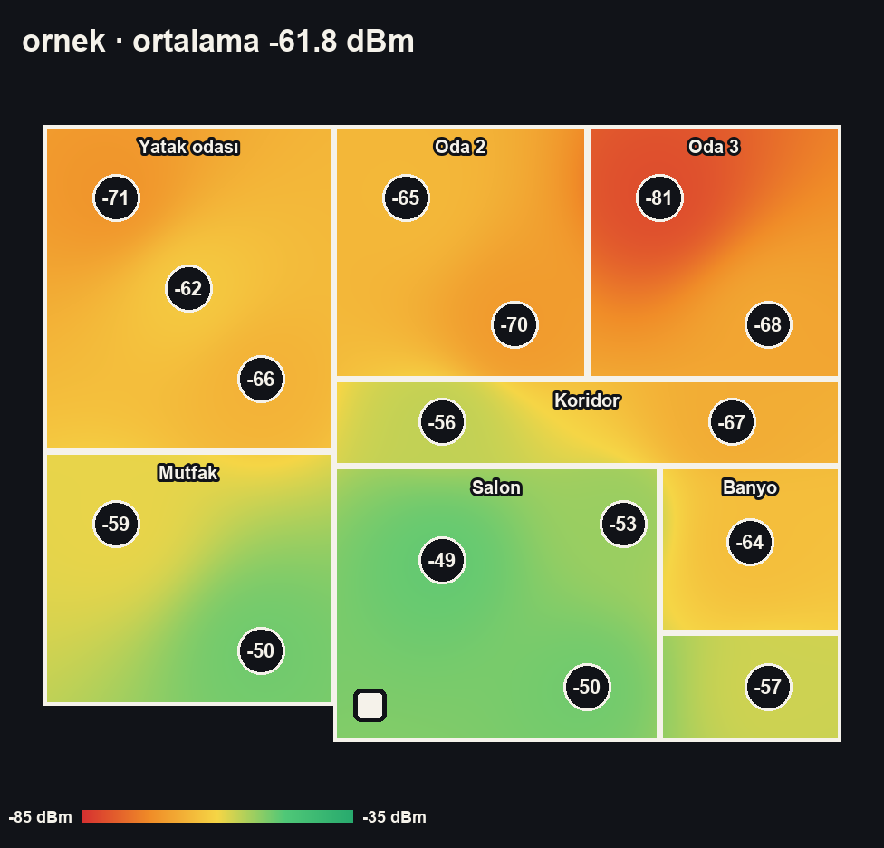
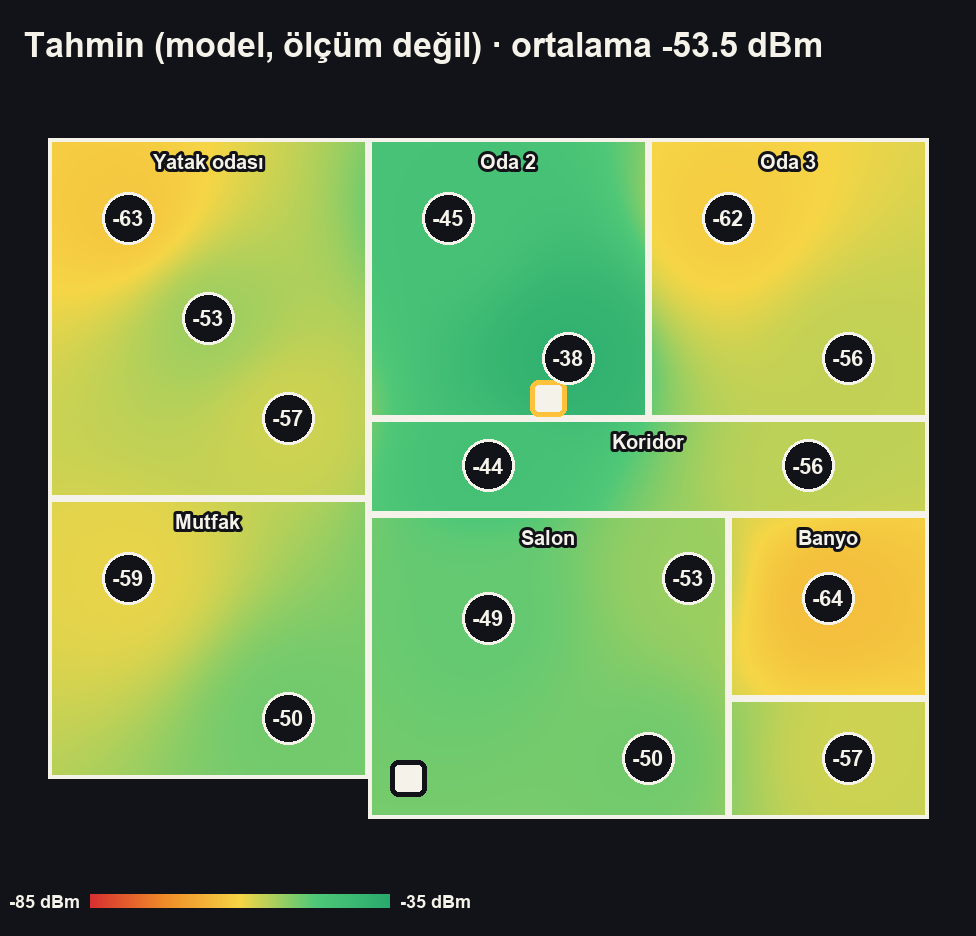

# Wi-Fi heat map

[Türkçe](README.md)

Measure your home Wi-Fi point by point with an iPhone and get a heat map on your floor plan. A simple signal model
suggests where to put the router or access points (mesh, extender). After moving them, measure the same points again
and compare before and after.

| Measured map | The model's estimate (+1 access point) |
|---|---|
|  |  |

The flat and the values in the images are the **synthetic example** in `example/`, not a real measurement.

## How it works

1. The iPhone shortcut reads the Wi-Fi signal (RSSI) 3 times at each point and sends it to a server on a computer at home.
2. The server appends the measurements to `data/measurements.csv`. The page it serves shows the plan and the points measured so far.
3. `heatmap.py` draws heat maps. Points in the same room weigh more, so the colour changes at walls.
4. `model.py` fits a signal model to the measurements and suggests where the access points should go.

## Requirements

- An iPhone with the Shortcuts app. The shortcut reads RSSI, noise, channel and BSSID with the "Get Network Details" action.
- A computer (Mac, Windows or Linux) on the same Wi-Fi with Python 3.9 or later.
- `numpy` and `pillow` for maps and the model: `pip install -r requirements.txt`. With [uv](https://docs.astral.sh/uv/),
  put `uv run --with numpy --with pillow` in front of the commands instead.

## Setup

```sh
git clone https://github.com/falconsw/wifi-heatmap.git
cd wifi-heatmap
python3 server.py --lang en
```

The server prints two lines: the address to open in a browser and the address for the shortcut (e.g.
`http://192.168.1.20:8777`). Run it on your home network only; it has no password.

### Shortcut

Send `shortcut/Wi-Fi Measure and Send.shortcut` to the iPhone and open it (AirDrop, iCloud Drive or download it from
this page). It asks for the server address while installing: enter the one `server.py` printed. Turkish version:
`shortcut/Wi-Fi Ölç ve Gönder.shortcut`.

On the first run the iPhone may ask for local network access: allow it. If the address changes, open the shortcut and
fix the address in its first "Text" action.

## Plan

Open the server's address in a browser and go to the **Plan** tab. The plan is in metres; the top left corner is (0, 0).

- **Room:** drag to draw a rectangle and name it. For an L-shaped room, select it and add a second rectangle with
  **Add to room**; no wall is counted between pieces of the same room.
- **Measurement point:** tap where you will measure. Numbers are given in order; the shortcut asks for this number.
  2–3 points per room is a good start.
- **Router/AP:** tap where the router and each access point stand. Their ids become `ap1`, `ap2`…; the model uses them.
- Fix things with **Move / select** and **Delete**. Every change is saved to `data/plan.json`.

Three ways to get the rooms in:

1. **Draw them:** draw the rooms on the metre grid with their rough sizes. A few centimetres do not change the result.
2. **Trace an image:** add a robot vacuum map, the floor plan from a listing or a photo of a sketch as the
   **Background**, enter its width in metres and draw the rooms over it.
3. **Describe them to an AI:** describe your home in an AI chat and let it write `plan.json`. Example prompt:

   > Turn my home into a plan.json in the format below. Units are metres, the top left corner is (0, 0), x to the right,
   > y downwards. Each room is one or more rectangles `[x, y, width, height]`. Put 2–3 measurement points in every room
   > and number them in order. Put the router in `aps`.
   > `{"size": [12, 10], "rooms": [{"id": "r1", "name": "Living room", "rects": [[0, 0, 5, 4]]}], "aps": [{"id": "ap1", "name": "Router", "x": 0.5, "y": 3.5}], "points": [{"n": 1, "x": 2, "y": 2}], "background": null}`
   > My home: (the rooms, their rough sizes, which room is next to which, where the router is)

   Save the result as `data/plan.json` and fix it in the Plan tab.

## Measuring

1. In the **Measure** tab, enter a round name (e.g. `before`). Every measurement goes into that round.
2. Stop at each point, run the shortcut and enter the point number. The phone takes 3 readings in about 3 seconds;
   the server keeps their median. Readings in a row at the same spot can differ by a few dB.
3. Hold the phone the same way and at the same height at every point. If you measure a point again, the last one counts.
4. Compare conditions in separate rounds: doors open / closed, 2.4 GHz / 5 GHz, old / new layout.

With mesh systems the phone may stay on a far access point. If so, turn Wi-Fi off and on before measuring; the `AP`
code in the server's reply shows which access point the phone was on.

## Maps

```sh
python3 heatmap.py                            # data/out/<round>.png for every round
python3 heatmap.py --compare before after     # before / after side by side
python3 heatmap.py --diff before after        # change per point, dB
```

Every map uses the same colour scale: -85 dBm red, -35 dBm green.

## Placement

```sh
python3 model.py --round before --move ap2    # where should ap2 go?
python3 model.py --round before --add 1       # where should a new access point go?
python3 heatmap.py --suggestion               # the estimated map
```

Model: `RSSI = P0 − 10·n·log10(distance) − W·walls`, from the strongest access point. P0, n and W are fitted to the
round's measurements. The suggestion is the spot that raises the average of the 5 weakest points the most. The "after"
values are the measured values plus the change the model predicts.

The model is rough: it does not know wall materials, furniture or doors. The leave-one-out error it prints shows how
far an estimate can be off. A suggestion is an estimate: after moving, measure again in a new round.

## Example

```sh
python3 server.py --data example              # the synthetic plan and measurements in the browser
python3 heatmap.py --data example
python3 model.py --data example --add 1
```

`example/make_example.py` writes the example again. Its values are the model formula plus random noise.

## Data and privacy

- Everything stays on your computer; the `data/` folder is not committed.
- The BSSID (the access point's MAC address) is not stored, only a 4-character hash of it.
- Turkish and English: the language selector on the page, `--lang en` or `WIFIHEATMAP_LANG=en` on the command line.

## License

MIT
