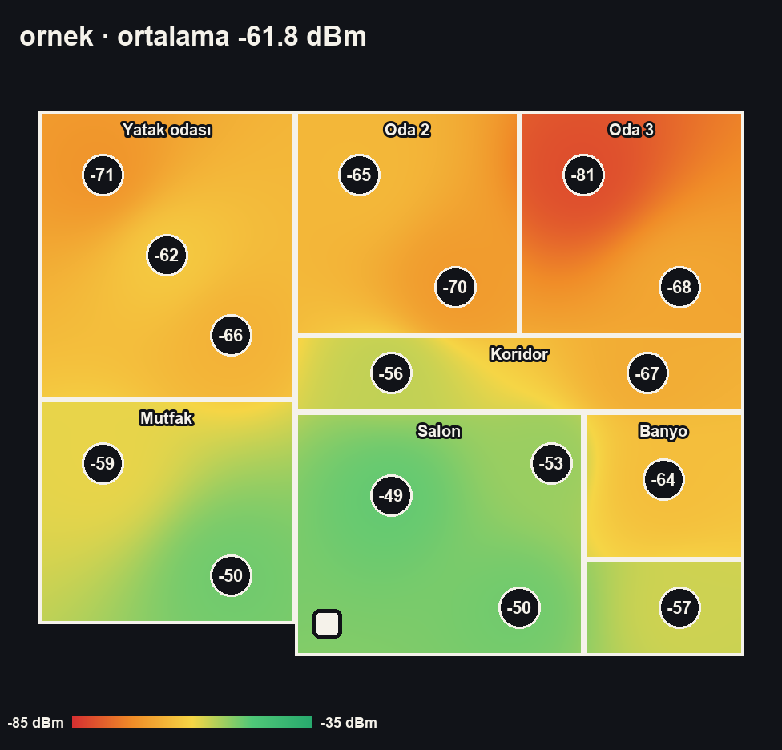
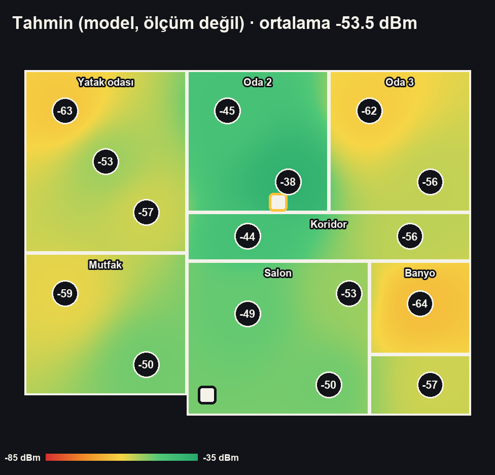

# Wi-Fi ısı haritası

[English](README.en.md)

Evdeki Wi-Fi sinyalini iPhone ile nokta nokta ölçer, kat planının üstünde ısı haritası çıkarır. Basit bir sinyal modeli
modem ya da erişim noktası (mesh, extender) için yer önerir. Taşıdıktan sonra aynı noktaları yeniden ölçüp önceyi ve
sonrayı karşılaştırırsınız.

| Ölçüm haritası | Modelin tahmini (+1 erişim noktası) |
|---|---|
|  |  |

Görsellerdeki ev ve değerler `example/` klasöründeki **sentetik örnektir**, gerçek ölçüm değildir.

## Nasıl çalışır

1. iPhone'daki kestirme her noktada Wi-Fi sinyalini (RSSI) 3 kez okur ve evdeki bilgisayarda çalışan sunucuya gönderir.
2. Sunucu ölçümleri `data/measurements.csv` dosyasına yazar. Telefonda açılan sayfada plan ve ölçülen noktalar görünür.
3. `heatmap.py` ölçümlerden ısı haritası çizer. Aynı odadaki noktalar daha ağır sayılır, renk duvarda değişir.
4. `model.py` ölçümlere bir sinyal modeli uydurur ve erişim noktalarının nereye konacağını önerir.

## Gerekenler

- iPhone ve Kestirmeler uygulaması. Kestirme, "Ağ Ayrıntılarını Al" eylemiyle RSSI, parazit, kanal ve BSSID okur.
- Aynı Wi-Fi ağında bir bilgisayar (Mac, Windows ya da Linux) ve Python 3.9 veya üstü.
- Harita ve model için `numpy` ve `pillow`: `pip install -r requirements.txt`. [uv](https://docs.astral.sh/uv/) varsa
  komutların başına `uv run --with numpy --with pillow` yazmanız yeterli.

## Kurulum

```sh
git clone https://github.com/falconsw/wifi-heatmap.git
cd wifi-heatmap
python3 server.py
```

Sunucu iki satır yazar: tarayıcıda açılacak adres ve kestirmeye yazılacak adres (ör. `http://192.168.1.20:8777`).
Sunucu yalnız ev ağınızda çalışmalı; parola sormaz.

### Kestirme

`shortcut/Wi-Fi Ölç ve Gönder.shortcut` dosyasını iPhone'a gönderip açın (AirDrop, iCloud Drive ya da bu sayfadan
indirerek). Kurulumda sunucunun adresini sorar: `server.py`'nin yazdığı adresi girin. İngilizce sürüm:
`shortcut/Wi-Fi Measure and Send.shortcut`.

İlk çalıştırmada iPhone yerel ağa erişim izni isteyebilir, izin verin. Adres değişirse kestirmeyi açıp ilk "Metin"
eylemindeki adresi düzeltin.

## Plan

Tarayıcıda sunucunun adresini açıp **Plan** sekmesine geçin. Plan metre cinsindendir; sol üst köşe (0, 0).

- **Oda:** sürükleyerek dikdörtgen çizin, adını yazın. L biçimli oda için odayı seçip **Odaya parça** ile ikinci bir
  dikdörtgen ekleyin; aynı odanın parçaları arasında duvar sayılmaz.
- **Ölçüm noktası:** ölçeceğiniz yerlere dokunun. Numaralar sırayla verilir, kestirme bu numarayı sorar. Her odaya
  2–3 nokta iyi bir başlangıçtır.
- **Modem/AP:** modemin ve her erişim noktasının yerine dokunun. Kimlikleri `ap1`, `ap2`… olur; model bu adları kullanır.
- **Taşı / seç** ile odayı, noktayı ya da modemi sürükleyin; **Sil** dokunduğunuz odayı, noktayı ya da sınırı siler.
  Her değişiklik `data/plan.json` dosyasına kaydedilir.

Odaları çizmenin üç yolu var:

1. **Elle çizmek:** metre ızgarasında odaları yaklaşık ölçüleriyle çizin. Birkaç santimetre fark sonucu değiştirmez.
2. **Robot süpürge haritasından almak:** uygulamadaki haritanın ekran görüntüsünü **Arka plan** ile ekleyin.
   - **Ölçek:** uzunluğunu bildiğiniz bir duvar boyunca çizgi çekip kaç metre olduğunu yazın; harita ve çizilenler
     buna göre ölçeklenir.
   - **Renkle doldur:** bir odanın rengine dokunun, o renkteki alan oda olur. Süpürgenin beyaz geçiş çizgileri, simgeler
     ve odanın içinde kalan yasak bölgeler odaya dahil edilir.
   - **Sınır:** aynı renkteki iki oda birbirine taşıyorsa aralarına çizgi çekin; doldurma o çizgide durur.
   - Odanın kenarında kalıp alınmayan bir yer olursa (ör. kenardaki yasak bölge) **Odaya parça** ile ekleyin.

   Emlak ilanındaki kat planı ya da kağıda çizilmiş bir planın fotoğrafı da aynı şekilde eklenir; renk yoksa odaları
   üstünden **Oda** ile çizin.
3. **Tarif edip yapay zekaya yazdırmak:** evinizi bir yapay zeka sohbetine anlatın, `plan.json` yazsın. Örnek istem:

   > Evimi aşağıdaki biçimde bir plan.json dosyasına çevir. Birim metre, sol üst köşe (0, 0), x sağa, y aşağı doğru.
   > Her oda bir ya da daha çok dikdörtgen: `[x, y, genişlik, yükseklik]`. Her odaya 2–3 ölçüm noktası koy ve sırayla
   > numarala. Modemin yerini `aps` içine yaz.
   > `{"size": [12, 10], "rooms": [{"id": "r1", "name": "Salon", "rects": [[0, 0, 5, 4]]}], "aps": [{"id": "ap1", "name": "Modem", "x": 0.5, "y": 3.5}], "points": [{"n": 1, "x": 2, "y": 2}], "background": null}`
   > Evim: (odaları, yaklaşık ölçülerini, hangisinin hangisine komşu olduğunu ve modemin yerini yazın)

   Çıkan dosyayı `data/plan.json` olarak kaydedin ve Plan sekmesinde düzeltin.

## Ölçüm

1. **Ölçüm** sekmesinde bir tur adı girin (ör. `once`). Her ölçüm o tura yazılır.
2. Her noktada durun, kestirmeyi çalıştırın, nokta numarasını girin. Telefon yaklaşık 3 saniyede 3 okuma alır;
   sunucu ortancasını kaydeder. Aynı noktadaki art arda okumalar birkaç dB oynayabilir.
3. Telefonu her noktada aynı yükseklikte ve aynı tutuşla tutun. Bir noktayı yeniden ölçerseniz son ölçüm geçerli olur.
4. Koşulları ayrı turlarda karşılaştırın: kapılar açık / kapalı, 2,4 GHz / 5 GHz, eski / yeni yerleşim.

Mesh sistemlerde telefon uzaktaki erişim noktasına bağlı kalabilir. Böyle olursa ölçmeden önce Wi-Fi'ı kapatıp açın;
sunucunun yanıtındaki `AP` kodu telefonun hangi erişim noktasına bağlı olduğunu gösterir.

## Harita

```sh
python3 heatmap.py                         # her tur için data/out/<tur>.png
python3 heatmap.py --compare once sonra    # önce / sonra yan yana
python3 heatmap.py --diff once sonra       # nokta başına değişim, dB
```

Renk ölçeği her haritada aynıdır: -85 dBm kırmızı, -35 dBm yeşil.

## Yerleşim önerisi

```sh
python3 model.py --round once --move ap2   # ap2 nereye taşınmalı?
python3 model.py --round once --add 1      # yeni bir erişim noktası nereye?
python3 heatmap.py --suggestion            # tahmini harita
```

Model: `RSSI = P0 − 10·n·log10(mesafe) − W·duvar sayısı`, en güçlü erişim noktasına göre. P0, n ve W turun
ölçümlerine uydurulur. Öneri, en zayıf 5 noktanın ortalamasını en çok yükselten yerdir. "Sonra" değerleri ölçülen
değer artı modelin öngördüğü değişimdir.

Model kabadır: duvarların malzemesini, mobilyayı ve kapıları bilmez. Yazdığı "birini dışarıda bırak" hatası,
tahminin ne kadar şaşabileceğini gösterir. Öneri bir tahmindir; taşıdıktan sonra yeni bir turda yeniden ölçün.

## Örnek

```sh
python3 server.py --data example           # sentetik planı ve ölçümleri tarayıcıda görün
python3 heatmap.py --data example
python3 model.py --data example --add 1
```

`example/make_example.py` örneği yeniden üretir. Değerler model formülüne rastgele gürültü eklenerek yazılmıştır.

## Veriler ve gizlilik

- Her şey bilgisayarınızda kalır; `data/` klasörü git'e girmez.
- BSSID (erişim noktasının MAC adresi) kaydedilmez, yalnız 4 karakterlik bir özeti tutulur.
- Arayüz Türkçe ve İngilizce: sayfadaki dil seçici, komut satırında `--lang en` ya da `WIFIHEATMAP_LANG=en`.

## Lisans

MIT
